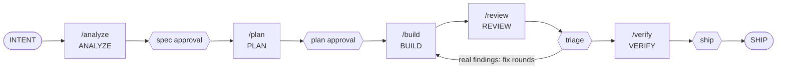

# Command reference

Every ANEW command on one page: what it does, what it reads and writes, where it stops, and how
lite and strict differ. This page is a map, not a second home for the rules — each entry points
at the file that defines it. Segment rules live in `workflows/segments.md`; when the two
disagree, that file wins and this page is out of date.

## Command map

The hexagons are the four human gates. `/new-feature` is the chainer: in lite it runs the whole
row above, asking at each gate; in strict it refuses and each role runs its own segment command.

Always available, outside the loop:

| Group | Commands |
|---|---|
| Terminal scripts | `scripts/init` · `scripts/doctor` · `scripts/check` · `scripts/residue` · `scripts/selftest` |
| Request lanes | `/change` (existing behavior) · `/fix-bug` (broken behavior) · `/refactor` (structure only) |
| Setup · record · recover | `/bootstrap` · `/adr` · `/recover` |

## How to read this page

Every command has the same fields:

- **What it does** — one or two lines.
- **When to use it** — the situation it is for.
- **Reads / writes** — the files it uses. Context lives in files, so this is where to look.
- **Stops at** — the gate, and the human decision it waits for.
- **Lite / Strict** — the behavioral difference, or "no difference".
- **Refusal** — the entry-check message, quoted verbatim from the source file, or "none".
- **Common mistake** — one sentence.

Mode is the `Mode:` line in `AGENTS.md`, set at bootstrap (`workflows/README.md`, Modes).

## A — Terminal scripts

### `scripts/init`
- **What it does:** installs one AI tool adapter into the repo root: `claude-code`,
  `github-copilot`, `cursor`, `codex` or `generic`.
- **When to use it:** once, before `/bootstrap`; again to add or refresh an adapter.
- **Reads / writes:** reads `adapters/<tool>/`; writes `CLAUDE.md` + `.claude/`, or `.github/`
  (`copilot-instructions.md`, `prompts/`, `agents/`, `instructions/`), or `.cursor/` (`rules/`,
  `commands/`), or `.agents/skills/` (Codex). Existing files are kept unless `--force`; `generic`
  writes nothing.
- **Stops at:** no gate; it prints the next step (`Next: open Claude Code here and run /bootstrap`).
- **Lite / Strict:** no difference — it runs before a mode exists.
- **Refusal:** an unknown adapter prints `Unknown adapter: <name>` and the usage (exit 1).
- **Common mistake:** `--force` over adapter files you customized — they are overwritten.

### `scripts/doctor`
- **What it does:** workspace health — required core files, recovery catalog, configuration
  (`AGENTS.md`, mode, language, `scripts/check.conf`), the ANEW base version (`.anew-version`),
  adapter presence and parity, this page's coverage, spec/plan gate consistency, twin and shipped specs, `specs/done/` immutability,
  evidence hygiene, fast-only evidence. `--strict` turns gate warnings into failures; CI runs it that way.
- **When to use it:** after bootstrap, before a PR, whenever the workspace feels off.
- **Reads / writes:** reads the working tree (and git, for `specs/done/` against a base ref);
  writes nothing.
- **Stops at:** exit 0 = healthy (warnings allowed), exit 1 = broken; `FAIL` / `WARN` lines say why.
- **Lite / Strict:** no difference. The `--strict` flag is not strict mode; the two are independent.
- **Refusal:** none — it reports.
- **Common mistake:** reading a local `WARN` as harmless — under `--strict`, in CI, it is a `FAIL`.

### `scripts/check`
- **What it does:** the single verification contract — runs the steps in `scripts/check.conf` in
  order, fail fast. `--fast` runs only the steps tagged `[fast]`.
  **Fast green is a working state; only full green is evidence.** (`docs/testing.md`, Two speeds,
  one contract)
- **When to use it:** `--fast` while iterating; plain `./scripts/check` at every handoff, PROVE
  step, ramp exit and in CI.
- **Reads / writes:** reads `scripts/check.conf` (format: `scripts/check.conf.example`); writes
  only what its steps write.
- **Stops at:** `CHECK GREEN (full, n steps, t s)` (exit 0) or `CHECK FAILED (full) at step: <name>` (exit 1).
- **Lite / Strict:** no difference.
- **Refusal:** `check: no scripts/check.conf yet.` (exit 1); an unknown argument prints the
  usage (exit 2).
- **Common mistake:** citing `CHECK GREEN (fast, …)` as evidence.

### `scripts/residue`
- **What it does:** the residue test (`docs/testing.md`, Resource hygiene) — runs check twice and
  names every process, or memory drop over the tolerance, that outlives a run. `--fast` tests the
  fast profile.
- **When to use it:** at bootstrap (both profiles), and whenever `scripts/check.conf` changes.
- **Reads / writes:** runs `scripts/check`; writes only a temp dir, deleted on exit.
- **Stops at:** `RESIDUE CLEAN (<profile>, 2 runs)` (exit 0) or `RESIDUE FOUND (<profile>)` (exit 1).
- **Lite / Strict:** no difference.
- **Refusal:** a red check stops it: `RESIDUE TEST ABORTED (<profile>): check failed in run <n> — the residue test needs a green check`.
- **Common mistake:** running it on a busy machine — whatever starts meanwhile is listed too.

### `scripts/selftest`
- **What it does:** proves that `scripts/check`, `scripts/doctor` and `scripts/residue` behave as
  documented, scenario by scenario.
- **When to use it:** after changing any ANEW script; CI runs it after doctor.
- **Reads / writes:** copies the ANEW core into a temp dir outside the repo; writes nothing in the repo.
- **Stops at:** `== selftest: <n> passed, <m> failed ==` (exit 1 on any failure).
- **Lite / Strict:** no difference.
- **Refusal:** none.
- **Common mistake:** editing a script and the selftest together to make it pass — a red selftest
  means the script now differs from its documentation.

## B — Start: `/bootstrap` and `/new-feature`

### `/bootstrap`
- **What it does:** adapts ANEW to your project through an interview — language, inspect,
  interview, generate, verify, report (`workflows/bootstrap.md`). An empty tree takes the
  greenfield flow; existing code takes the adoption flow (stack and conventions detected from the
  code, confirmed rather than asked; flag changes proposed, never imposed).
- **When to use it:** once per project, right after `scripts/init`; rerun to revise.
- **Reads / writes:** reads `AGENTS.md`, `prompts/bootstrap.md` and the working tree; writes
  `docs/*.md`, `scripts/check.conf`, the `Mode` and `Language` lines and the project summary in
  `AGENTS.md` (invariant rules kept verbatim).
- **Stops at:** language · interview answers · the final report, where you approve the workspace.
  The report ends with the first command for the mode.
- **Lite / Strict:** it sets the mode; it runs the same in both.
- **Refusal:** none.
- **Common mistake:** skipping the VERIFY step's residue test — a bootstrap that fails it is not done.

### `/new-feature`
- **What it does:** the chainer, not a segment. Reads `Mode` from `AGENTS.md` first.
  Rule: **Segments always stop; /new-feature flows only as far as the mode allows.**
- **When to use it:** lite — every new feature starts here.
- **Reads / writes:** `AGENTS.md`, `workflows/segments.md`; then whatever each segment reads and writes.
- **Stops at:** spec approval · plan approval · triage · ship, continuing only on explicit approval.
  A matching spec in `specs/active/` is resumed from its next gate, never twinned.
- **Lite / Strict:** lite chains `/analyze` → `/plan` → `/build` → `/review` → `/verify`;
  strict refuses before any stage; unset stops (bootstrap has not run).
- **Refusal (strict, in the chat language, command names verbatim):** "Mode is strict: stages are
  role-owned. Analyst starts with /analyze; subsequent roles run /plan, /build, /review, /verify in
  their own sessions."
- **Common mistake:** expecting it to flow past a gate — it asks at every one, in every mode.

## C — The five segment commands

Each runs one segment of `workflows/segments.md`: entry check from files, work with its prompt,
gate, handoff ending in `Next: <segment> — <who runs it>`, stop.

### `/analyze`
- **What it does:** intent → clarify → spec (with self-critique) → spec approval.
- **When to use it:** strict — the Analyst starts a feature; lite — to resume at this gate.
- **Reads / writes:** `prompts/clarify.md`, `prompts/spec.md`, `specs/active/`, `specs/done/`,
  `specs/plans/` (for the next number); writes `specs/active/NNNN-<name>.md` and sets
  `Status: Approved`.
- **Stops at:** spec approval — "no open questions remain" · `Next: PLAN — Developer`.
- **Lite / Strict:** lite folds clarify into the draft and the approval is a quick yes/no — never
  skipped; strict clarifies first, then drafts.
- **Refusal:** no fixed message — a matching spec in `specs/active/` is offered for resuming; a
  second spec for the same work is never opened.
- **Common mistake:** asking it for a plan — it never produces one.

### `/plan`
- **What it does:** a plan from the Approved spec, then plan approval recorded in the plan.
- **When to use it:** after spec approval; again to revise a plan.
- **Reads / writes:** reads `specs/active/NNNN-*.md`, `prompts/plan.md`; writes
  `specs/plans/NNNN-plan.md` with `Approved by / on: <name>, <YYYY-MM-DD>`.
- **Stops at:** plan approval · `Next: BUILD — Developer`. It writes no code.
- **Lite / Strict:** no difference in checks or gate; in strict, the Developer runs it in a new session.
- **Refusal:** "Spec not approved — run ANALYZE or get approval first."
- **Common mistake:** approving in chat — only the filled `Approved by / on` line counts.

### `/build`
- **What it does:** implements the approved plan until `./scripts/check` is green.
- **When to use it:** after plan approval; again to resume an `In progress` build, or for fix
  rounds after triage (`prompts/build.md §fixes`).
- **Reads / writes:** reads `specs/plans/NNNN-plan.md`, the spec, `prompts/build.md`; writes code
  and tests and sets the spec to `Status: In progress`.
- **Stops at:** changed files vs. the plan list + real `./scripts/check` output ·
  `Next: INDEPENDENT REVIEW — fresh session / read-only reviewer`. A deviation goes to R-07.
- **Lite / Strict:** no difference in checks; in strict, a session of its own.
- **Refusal:** "Plan not approved — run PLAN and get the approval recorded first."
- **Common mistake:** reviewing its own build — the producer never verifies its own work.

### `/review`
- **What it does:** an independent, read-only review of the diff against the spec.
- **When to use it:** after a build, and again on every fix diff.
- **Reads / writes:** reads the diff, the spec in `specs/active/`, its plan in `specs/plans/`
  (file list, criterion ↔ test map), `prompts/review.md`; writes nothing.
- **Stops at:** the findings report, verbatim · `Next: TRIAGE — human (real / noise / investigate); then Developer fix rounds, then VERIFY`.
- **Lite / Strict:** no difference — independent review is never optional, in any mode: a
  read-only reviewer (the `reviewer` subagent in Claude Code) or a fresh session.
- **Refusal:** none — a soft check: without a branch/diff and a spec `In progress`, it says so and asks.
- **Common mistake:** fixing findings in the same step — triage comes first, and it is the human's.

### `/verify`
- **What it does:** QA — maps every acceptance criterion to evidence (`docs/testing.md`,
  Evidence policy).
- **When to use it:** after triage is complete.
- **Reads / writes:** reads the spec, `prompts/verify.md`, test output; writes no production code.
- **Stops at:** the criterion ↔ evidence table · `Next: SHIP — human (DoD, PR, merge, move spec to specs/done/, Status: Shipped)`.
- **Lite / Strict:** no difference; in strict, QA in a fresh session.
- **Refusal:** none — a soft check: with no review/triage record, it says so and asks.
- **Common mistake:** a claim without evidence in the table — that is a gap, and gaps are findings.

## D — Request lanes: `/change`, `/fix-bug`, `/refactor`

### `/change`
- **What it does:** changes a behavior that already exists. Triage first, three questions in
  order (`workflows/change-request.md`): (a) deviation from what was agreed? → BUG;
  (b) does an acceptance criterion change or appear? → CHANGE, else TRIVIAL;
  (c) does it touch shared code? → CHANGE. Three lanes: BUG → `/fix-bug` · TRIVIAL → one narrow
  commit per the `docs/git.md` "Trivial changes" policy · CHANGE → mini-spec from
  `specs/TEMPLATE-mini.md` (`Source:` mandatory, changed + preserved criteria).
- **When to use it:** any request to change existing behavior, however small it sounds.
- **Reads / writes:** `workflows/change-request.md`, `docs/git.md`; writes a mini-spec in
  `specs/active/` (CHANGE) or one commit (TRIVIAL).
- **Stops at:** the triage verdict, which you confirm; then the lane's gates.
- **Lite / Strict:** strict runs only ANALYZE (mini) and stops at `Next: PLAN — Developer runs /plan <NNNN>`;
  lite chains the lane, asking at every gate — the plan gate is never skipped.
- **Refusal:** none — an open spec with the same `Source:` key is offered for resuming.
- **Common mistake:** triaging by how small the request sounds instead of by the behavior test.

### `/fix-bug`
- **What it does:** the bug-fix workflow (`workflows/bug-fix.md`): report → red reproduction test →
  diagnose → fix → prove → review → ship. No fix before a failing minimal reproduction test.
- **When to use it:** the behavior deviates from what was agreed (triage question (a)).
- **Reads / writes:** reads the report and `workflows/bug-fix.md`; writes the reproduction test
  (permanent) and the fix.
- **Stops at:** the reproduction (or a reasoned close) · triage of the fix review.
- **Lite / Strict:** no difference — triage is a human gate in every mode.
- **Refusal:** none — but no fix is written before the reproduction test is red.
- **Common mistake:** a fix that changes behavior — that is the CHANGE lane, mini-spec first.

### `/refactor`
- **What it does:** structure changes, behavior provably unchanged (`workflows/refactor.md`). The
  spec is a mini-spec: Changed behavior = *none — no observable behavior change*; Preserved
  behavior = the characterization criteria.
- **When to use it:** cleaning up structure without changing what the code does.
- **Reads / writes:** `workflows/refactor.md`, `specs/TEMPLATE-mini.md`; writes
  `specs/active/NNNN-refactor-<name>.md`, a plan, characterization tests (if missing), the refactor.
- **Stops at:** approval of spec and plan · triage of the review.
- **Lite / Strict:** no difference.
- **Refusal:** none — but `./scripts/check` must be green before it starts.
- **Common mistake:** editing a test — a needed test edit means behavior changed; stop.

## E — Record and recover: `/adr`, `/recover`

### `/adr`
- **What it does:** discusses an architecture decision, then records it from
  `docs/decisions/TEMPLATE.md` (`docs/decisions/README.md`).
- **When to use it:** a significant, hard-to-reverse choice — when it is made.
- **Reads / writes:** `prompts/adr.md`; writes `docs/decisions/NNNN-<slug>.md`.
- **Stops at:** your decision, before anything is written.
- **Lite / Strict:** no difference.
- **Refusal:** none.
- **Common mistake:** changing an accepted ADR's decision in place — a new decision gets a new ADR.

### `/recover`
- **What it does:** picks the matching recovery ramp, says which and why, then runs its prompt.
- **When to use it:** something went wrong — a red build, a drifting plan, a foggy context.
- **Reads / writes:** `prompts/recovery/README.md` and the ramp's file; writes what that ramp allows.
- **Stops at:** your confirmation of the ramp; then the ramp's own rules.
- **Lite / Strict:** no difference.
- **Refusal:** none — no match is treated as R-10 (ambiguity).
- **Common mistake:** improvising a fix instead of naming the ramp.

## Recovery ramps

Ramps are safe returns to the loop, not alternatives to it — each carries its own protection
rules. The agent names the ramp's code and asks the human to run it; the catalog, R-01…R-12,
lives in [`prompts/recovery/README.md`](../prompts/recovery/README.md).

## Quick reference

| Command | One line | Stops at | Lite | Strict |
|---|---|---|---|---|
| `scripts/init` | Install an adapter | Prints next step | Same | Same |
| `scripts/doctor` | Workspace health; `--strict` in CI | Exit 0 / 1 | Same | Same |
| `scripts/check` | The verification contract; `--fast` to iterate | `CHECK GREEN` / `CHECK FAILED` | Same | Same |
| `scripts/residue` | Check leaves nothing running | `RESIDUE CLEAN` / `RESIDUE FOUND` | Same | Same |
| `scripts/selftest` | ANEW's scripts behave as documented | Pass / fail count | Same | Same |
| `/bootstrap` | Adapt ANEW to the project | Language · interview · report | Sets the mode | Sets the mode |
| `/new-feature` | Chain the segments | Each of the four gates | Chains | Refuses |
| `/analyze` | Intent → approved spec | Spec approval | Clarify folded into draft | Clarify first |
| `/plan` | Approved spec → approved plan | Plan approval | Same | Own session |
| `/build` | Approved plan → green check | Handoff with check output | Same | Own session |
| `/review` | Independent, read-only review | Findings → triage | Same | Same |
| `/verify` | Criteria ↔ evidence | Table → ship | Same | Own session |
| `/change` | Triage, then the lane | Verdict; lane gates | Chains the lane | ANALYZE (mini) only |
| `/fix-bug` | Red reproduction first | Repro · triage | Same | Same |
| `/refactor` | Behavior unchanged, proven | Approval · triage | Same | Same |
| `/adr` | Record a decision | Your decision | Same | Same |
| `/recover` | Run the matching ramp | Ramp confirmation | Same | Same |

## Two golden rules

1. **Segments always stop.** Every segment ends at its handoff; only `/new-feature` (lite) moves on,
   and only after you approve.
2. **The four human gates — spec approval, plan approval, triage, ship — are never automated, in
   any mode.**

The same commands exist in Claude Code, Cursor, GitHub Copilot and Codex (`./scripts/init <tool>`;
in Codex they are skills, typed `$analyze` instead of `/analyze`); any other tool uses the generic
adapter and pastes the prompts (`adapters/generic/README.md`). How strongly each rule holds per
tool is the README's "How strongly is each rule held?" table.
